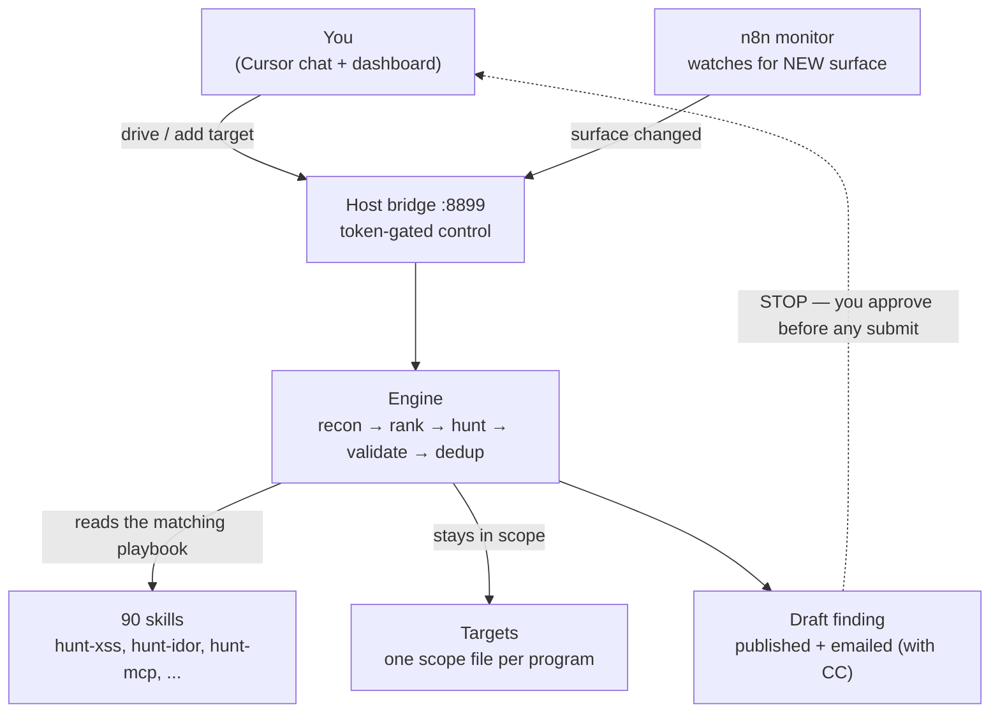
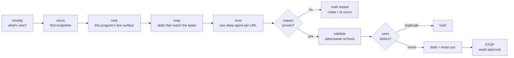
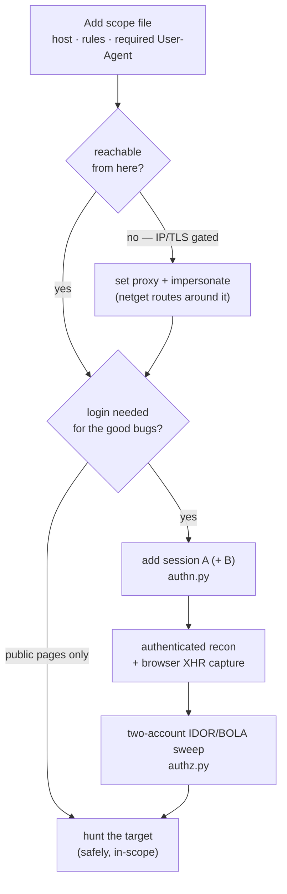

# 0xRay Hunt Harness


An autonomous, **anti-duplicate** bug-bounty hunting harness. It runs on **OpenCode + Claude Code** agents, tests
**read-only by default**, stays **in-scope**, and **stops at draft — it never submits for you**.

Integrates with **Burp Suite Professional** (MCP), **ContextPilot** (research), and a **self-learning skill system** that evolves playbooks from hunt outcomes.

---

## In plain English

Think of it as a **robot bug-bounty hunter** you supervise:

1. You give it a **target** (a website or an app's API) by dropping in a small config file.
2. It **looks around** the target the way a browser would, and figures out what's worth testing.
3. It **tests safely** — read-only, only in-scope, no brute force, no scanners hammering the site.
4. When it finds a **real, proven** bug, it writes you a **draft report** and **emails** you.
5. It **never submits** anything — you review and decide. If it finds nothing, it says so honestly
   (it won't invent a bug), and keeps looking on the next round.

Everything about a target — which host, the rules, the login session, even a proxy — lives in that
one **config file (the "scope")**, so adding a new program never means changing code.

---

## How it all fits together



**In plain English:** you (or the n8n monitor) kick off a hunt through the bridge. The engine does the
work, guided by the skill playbooks and fenced in by each target's scope, and hands you a draft at the
end. Nothing leaves without your say-so.

---

## How a single hunt works



**In plain English:** it hunts newest surface first, only claims a bug when it can actually *prove*
impact, double-checks itself, drops anything that's already been reported, and then stops at a draft.
"No finding this round" is a status, not the end — it re-looks next time.

---

## Adding a target (no code changes — just a scope file)



**In plain English:** you add a target as a config file. If the site blocks our server, we route
through a proxy with a real browser fingerprint. The bugs that pay (reading other users' data, broken
access control) live **behind login**, so if you give it a logged-in session — ideally two accounts —
it hunts that deeper surface and automatically checks whether account B can read account A's data.

**Or just paste the page:** on the dashboard go to **Targets → Add by pasting the program page**, paste
the whole YesWeHack / HackerOne / Bugcrowd program page, and it auto-fills the in/out-of-scope hosts,
qualifying + non-qualifying classes, reward grid, and the mandatory User-Agent — no config editing.

---

## Repository layout

| Path | What it is |
|------|------------|
| [`harness/`](harness/) | the glue: n8n `docker-compose`, the novelty-monitor workflow, launch scripts |
| [`harness/.env.example`](harness/.env.example) | every setting documented — copy to `.env` and fill in |
| [`.claude/`](.claude/) | Claude Code agents + skills (hunt, report, triage, research) |
| [`engine/`](engine/) | the full engine (41 modules) + 90 skills |
| [`MANUAL.md`](MANUAL.md) | the deep operator manual (dashboard, sessions, ops, troubleshooting) |
| [`Makefile`](Makefile) | one-command setup, run, and the CI gates |

## Quick start

Prereqs: Linux/WSL, Python 3.10+, Go recon tools (`~/go/bin/`), and [OpenCode](https://github.com/opencode-ai/opencode) or Claude Code.

```bash
make setup        # copy harness/.env.example -> harness/.env, then edit it
make n8n-up       # start the isolated hunting n8n
make import       # import the novelty-monitor workflow (credential-free: emails via the bridge)
make bridge       # start the token-gated host bridge under pm2

# start a hunt (3h loop, crash-safe, resumes from saved state)
cd harness && pm2 start ./hunt-run.sh --name hunt-acme -- /path/to/acme.scope.json 10800
```

Run `make` with no target to see every command.

## What's new (the "find more bugs" upgrade)

The harness can now reach the surface where the paid bugs actually live:

- **No static hunt catalog** — ranking, skill pick, and session health come from *this* program's
  live surface and the operator paste, not a baked-in list of classes, paths, or products.
- **Auto-relogin** (`authsession.py` creds vault) — store the login URL + cookies or
  username/password from a paste. When a JWT/session dies, hunt and reviewer replay that URL
  and refresh. Password never goes in logs.
- **Reviewer heal loop** (`reviewer.py`, ~60s) — false-dead sessions, idle mines, and stale
  processes get fixed and published to the panel (`live.json`) without a manual restart.
- **Authenticated sessions** (`authn.py`) — drop in a logged-in session, with two accounts A + B.
- **Headless-browser capture** (`browser.py`, Playwright) — see the real XHR/fetch/GraphQL API that a
  plain crawler misses on single-page apps.
- **IDOR/BOLA sweep** (`authz.py`) — replay a request as A vs B and flag where B reads A's data (the
  #1, best-paying bug class). Always confirmed with a real two-account PoC before drafting.
- **Edge bypass** (`netget.py`) — per-target proxy + browser TLS fingerprint for geo/IP-gated APIs.
- **APK → API surface** (`apkmap.py`) — pull endpoints + secrets from a mobile app, even if its live
  API is blocked from our host.
- **Coverage report** (`coverage.py`) — so "0 findings" is backed by a visible list of what was tested.
- **Add a target by pasting its program page** (`scopeparse.py` + panel) — auto-extracts scope,
  out-of-scope, qualifying/non-qualifying classes, reward grid, and the mandatory User-Agent.
- **Verify a finding before reporting** (`verify.py` + the panel's **Verify finding** tab) — paste a
  draft *or upload the report + evidence files*, and get READY / NEEDS-FIXES / DO-NOT-SUBMIT with a
  PoC/impact/scope/dedup checklist (optional deep LLM expert review; uploads are security-hardened).

See [`CHANGELOG.md`](CHANGELOG.md) for the full history.

## Burp Suite Professional Integration

When Burp Pro is running (locally or via WSL→Windows port forwarding), agents automatically get:

- **HTTP via Burp** — `send_http1/2_request`, all traffic in proxy history + sitemap
- **Collaborator OOB** — `generate_collaborator_payload` + `get_collaborator_interactions`
- **Scanner** — `get_scan_issues` for passive/active findings
- **Repeater/Intruder** — send requests for manual follow-up
- **Proxy auto-routing** — `netget.py` routes all requests through Burp when reachable
- Setup: `python3 engine/engine/burp.py setup` + `bash harness/burp-forward.sh start` (WSL)

## Self-Learning Skill System

The harness teaches itself. When it encounters an unknown stack, vuln class, or bypass:

1. `learn.py auto --kind <tech|vuln|bypass|program>` — researches and drafts a new SKILL.md
2. Hunt outcomes (`confirmed`, `false-positive`, `duplicate`) feed back into the journal
3. `evolve_skill()` auto-refines learned skills with proven vectors and FP patterns
4. Skills are pull-on-demand references — agents reason from the live response first

## Program Intake

Universal program URL → engagement pipeline:

```bash
python3 engine/engine/intake.py start "https://hackerone.com/acme"
python3 engine/engine/intake.py start --platform bugcrowd --slug acme
```

Supports H1, Bugcrowd, YesWeHack, Intigriti. Auto-detects platform from URL, fetches scope via bb-platforms MCP, converts to engine scope.json, creates engagement directory.

## Deep Functional Mapping

Before hunting, the harness maps the target's full attack surface:

- **Feature → Action → Endpoint → Method → Parameters → Auth → Test Opportunities**
- Sources: profile agent, browser capture (forms/buttons/XHR), JS bundle analysis (fetch/axios detection), Burp proxy history, OpenAPI introspection
- Outputs: `feature-map.json`, `feature-map.md`, `endpoints.jsonl` per engagement
- Coverage section distinguishes observed-in-traffic from security-tested endpoints
- Annotates test opportunities: IDOR/BOLA, SSRF, auth-bypass, payment-logic, file-upload, GraphQL, etc.

## Skills catalog (90)

Each `hunt-*` skill is a playbook: *what actually pays*, how to detect it, the minimum proof, and a
dedup gate. Plus auto-learned tech skills that evolve from hunt outcomes.

- **Recon & novelty** — `web2-recon` · `offensive-osint` · `osint-methodology` · `hunt-subdomain` · `hunt-source-leak` · `changed-js-deepdive` · `hunt-ntlm-info` · `supply-chain-attack-recon`
- **Injection & server-side** — `hunt-sqli` · `hunt-nosqli` · `hunt-ssrf` · `hunt-rce` · `hunt-lfi` · `hunt-ssti` · `hunt-xxe` · `hunt-deserialization` · `hunt-ldap` · ✨`hunt-webhook`
- **Client-side** — `hunt-xss` · `hunt-dom` · `hunt-cors` · `hunt-csrf` · `hunt-open-redirect` · `hunt-cache-poison`
- **Access control & logic** — `hunt-idor` · `hunt-business-logic` · `hunt-race-condition` · `hunt-file-upload` · `hunt-host-header` · `hunt-http-smuggling`
- **Auth · identity · session** — `hunt-auth-bypass` · `hunt-oauth` · `hunt-saml` · `hunt-mfa-bypass` · `hunt-ato` · `hunt-session` · ✨`hunt-jwt` · `hunt-brute-force`
- **API** — ✨`hunt-api-owasp` · `hunt-api-misconfig` · `hunt-graphql` · `hunt-grpc` · `hunt-websocket`
- **Framework-specific** — `hunt-nextjs` · `hunt-nodejs` · `hunt-laravel` · `hunt-springboot` · `hunt-aspnet` · `hunt-sharepoint`
- **Cloud · infra · appliances** — `hunt-cloud-misconfig` · `cloud-iam-deep` · `hunt-k8s` · `hunt-cicd` · `hunt-tls-network` · `enterprise-vpn-attack` · `vmware-vcenter-attack` · ✨`hunt-baas`
- **Identity providers** — `m365-entra-attack` · `okta-attack`
- **Desktop / mobile** — ✨`hunt-desktop-macos` · ✨`hunt-desktop-windows` · `apk-redteam-pipeline`
- **AI / agents** — `hunt-llm-ai` · `hunt-mcp`
- **New** — `hunt-2fa-bypass` · `hunt-crlf` · `hunt-payment-logic` · `hunt-pdf-ssrf` · `hunt-prototype-pollution` · `hunt-methodology`
- **Web3** — `web3-audit` · `meme-coin-audit`
- **Methodology · reporting** — `bb-methodology` · `bug-bounty` · `bb-local-toolkit` · `dedup-novelty` · `triage-validation` · `redteam-mindset` · `mid-engagement-ir-detection` · `evidence-hygiene` · `report-writing` · `bugcrowd-reporting` · `redteam-report-template` · `security-arsenal` · `hunt-dispatch` · `hunt-misc`
- **Auto-learned** — tech playbooks drafted on-the-fly for unknown stacks (BigIP, Express, TYPO3, Istio-Envoy, etc.)

## Safety contract

- **Read-only by default** — the only "write" is guardrail-gated test-account creation on in-scope
  targets (capped + audited).
- **No brute force / password cracking** — refused by policy.
- **In-scope only** — recon + hunt are filtered to scope at every boundary.
- **Stop at draft** — nothing is ever submitted without your explicit, per-report approval.
- **Evidence-only** — findings claim exactly what was proven; no "could potentially".

See [SECURITY.md](SECURITY.md) for the full responsible-use policy.

## Testing & CI

```bash
make selfcheck     # crash/loop/hostile-input gauntlet — 57/57
make e2e           # end-to-end pipeline trace
make skills-lint   # frontmatter, naming, secret + client-identifier scan over all skills
make secret-scan   # fail if obvious secrets are present in the tree
```

CI ([`.github/workflows/ci.yml`](.github/workflows/ci.yml)) runs **secret-scan** and **skills-lint**.
GitHub Actions needs billing on the account; while it's off the workflow is **manual**
(`workflow_dispatch`) so pushes never show a failed run — run the same gates locally with `make`, or
install the pre-push hook once with `make hooks`.

## Project docs

[`MANUAL.md`](MANUAL.md) · [`SECURITY.md`](SECURITY.md) · [`CONTRIBUTING.md`](CONTRIBUTING.md) ·
[`CHANGELOG.md`](CHANGELOG.md) · [`LICENSE`](LICENSE)

---

*Harness branding: 0xRay. Engine © its authors (see [`engine/LICENSE`](engine/LICENSE)).*
